<p align="center"></p>
<p align="center"><b>Your AI. Your Pocket. Your Rules.</b><br>
Sua IA. Seu bolso. Suas regras.</p>
<p align="center">
  
  
  
  
</p>

### Ligue para a sua IA. Mesmo sem sinal.

**Chamada de voz ao vivo, 100% no iPhone:** você fala, ela responde em voz e você interrompe quando quiser — em modo avião, sem nuvem, sem o seu áudio sair do aparelho. E mais: converse por texto, organize o dia, prepare lembretes e mensagens, crie imagens e peça socorro **até sem sinal**. O PocketSelf roda **dentro do iPhone**, só age quando **você confirma** e só lembra do que **você aprovar**. Grátis, código aberto, sem conta.

<p align="center">
  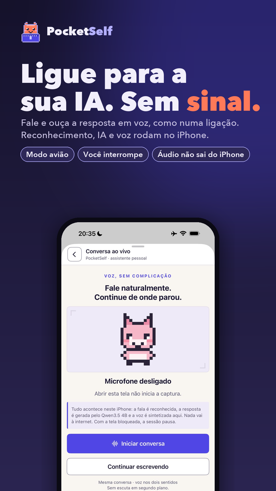
  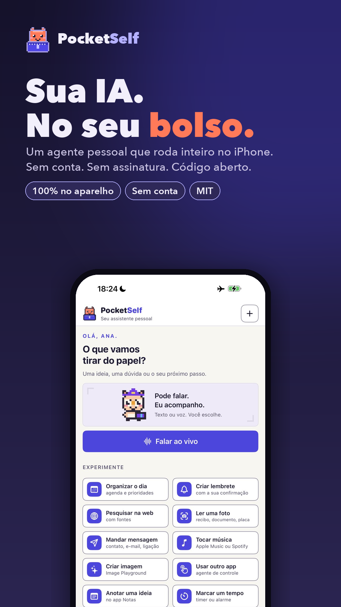
  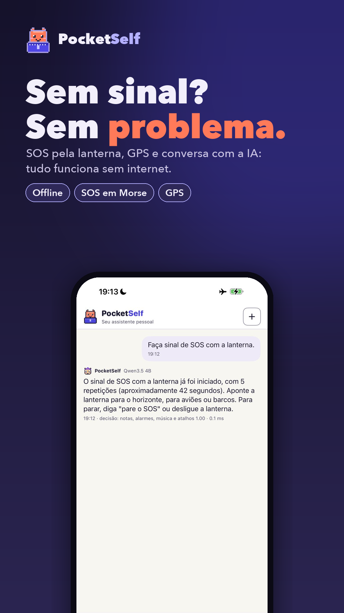
  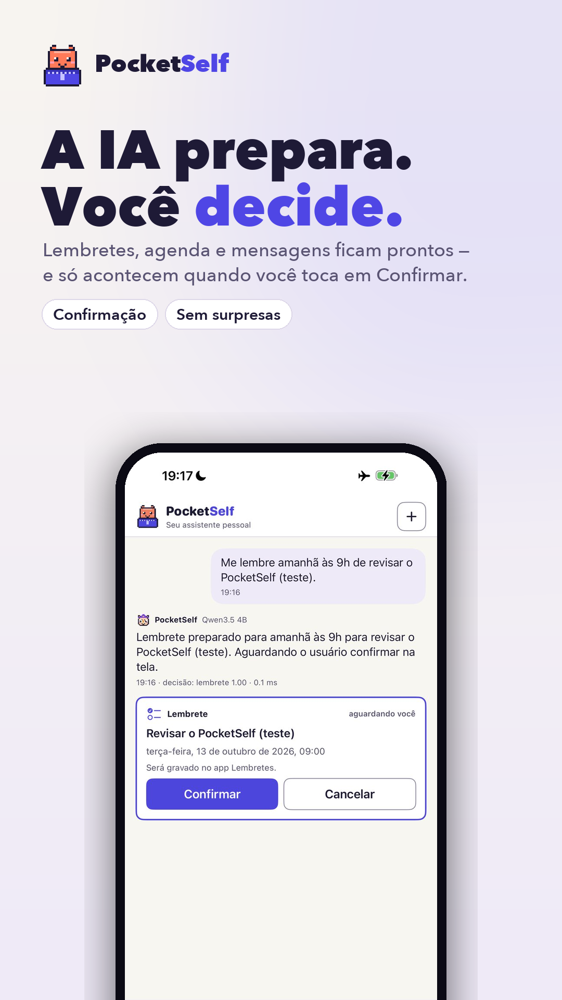
  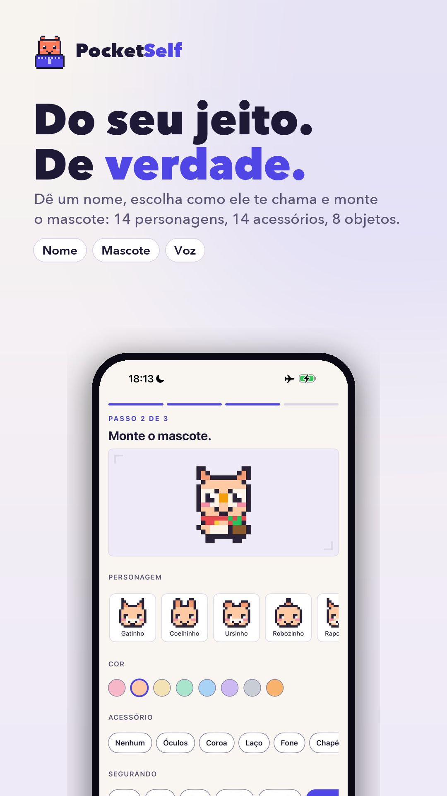
</p>

| 📵 **Fala com você, sem sinal** | 🛡️ **Você no controle** | 🧠 **Feito para evoluir** |
|---|---|---|
| Chamada ao vivo com reconhecimento, IA e voz no aparelho. SOS pela lanterna e GPS também offline. | Ações só com o seu toque. Memória só com a sua aprovação. Mensagens exatamente como você escreveu. | Qwen, Gemma, Apple Intelligence ou o seu servidor — até **47 tokens/s** medidos num iPhone 17 Pro Max. |

<p align="center">
  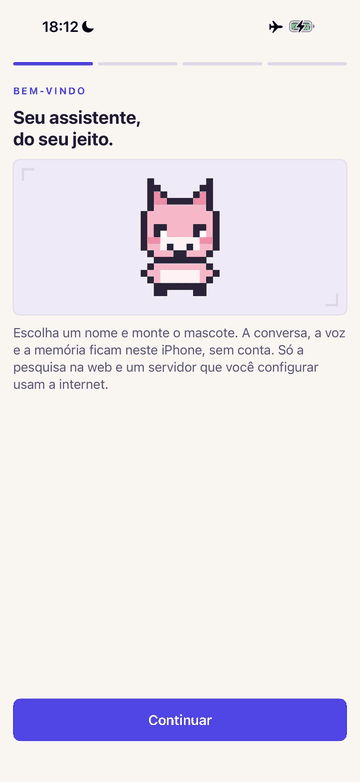
  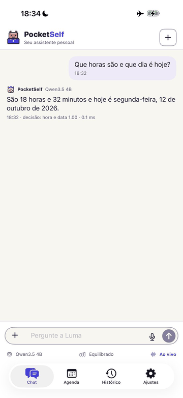
</p>

> **English (short):** PocketSelf is a free, MIT-licensed, local-first personal AI agent for iPhone (SwiftUI + MLX). It chats and talks on-device, reads photos, searches the web, manages reminders/calendar with explicit confirmation, keeps user-approved memory, and includes an on-device XCUITest agent that can operate other apps. Docs are in Brazilian Portuguese; see `docs/INSTALACAO.md` and `docs/INSTALACAO-COM-IA.md`.

## Instalar em 3 caminhos

| Caminho | Para quem | Onde |
|---|---|---|
| **Pela sua IA de código** (Claude Code ou Codex) | quem quer o mínimo de esforço | [docs/INSTALACAO-COM-IA.md](docs/INSTALACAO-COM-IA.md) — cole um prompt e acompanhe |
| **Por script** | quem tem Xcode e quer controle | `scripts/verificar-ambiente.sh` → `scripts/instalar-no-iphone.sh --team SEU_TEAM_ID` |
| **Passo a passo manual** | quem quer entender cada etapa | [docs/INSTALACAO.md](docs/INSTALACAO.md) |

⚠️ **Conta gratuita da Apple: a assinatura vale 7 dias.** O app para de abrir depois disso; reinstalar pelo mesmo script renova (os dados ficam). Detalhes e alternativas em [docs/ASSINATURA-7-DIAS.md](docs/ASSINATURA-7-DIAS.md).

## O que já funciona (resumo honesto)

Legenda: ✅ validado em aparelho · 🟡 parcial/experimental · 🔲 planejado. Matriz completa com evidências: [docs/FUNCIONALIDADES.md](docs/FUNCIONALIDADES.md) · auditoria: [docs/VALIDACAO-FUNCIONAL.md](docs/VALIDACAO-FUNCIONAL.md).

| | |
|---|---|
| ✅ Chat local (Qwen3.5 4B/9B, Gemma 4 E2B/E4B via MLX) | troca de motor sem perder histórico |
| ✅ **Chamada ao vivo offline** | fala reconhecida no aparelho, resposta do modelo local e voz sintetizada no iPhone; você interrompe quando quiser |
| 🟡 **Reunião**: ouve, transcreve, organiza e resume | transcrição longa no aparelho (75 s de áudio em 4,4 s no iPhone 17); notas e resumo em validação |
| ✅ **Sem sinal: SOS e GPS** | a lanterna pisca SOS em Morse; o GPS dá suas coordenadas, sem internet |
| ✅ **Suas palavras, exatamente** | mensagens e e-mails vão como você escreveu, mesmo se a IA errar uma palavra |
| ✅ Decide («Sistema 1» próprio) | intenção em ~0,1 ms com probabilidade calibrada; abaixo de 80% não decide |
| ✅ Lembretes, timer, lanterna, brilho · 🟡 agenda, notas, alarme | ações com efeito só depois do seu toque de confirmação |
| ✅ Web: pesquisar e ler páginas | conteúdo da web é tratado como dado, nunca como ordem |
| ✅ Fotos: texto e contexto no aparelho (Vision) · Gemma 4 vê imagens | |
| ✅ Mensagem · 🟡 contatos, e-mail, ligação, música, Atalhos | sempre com confirmação na tela |
| ✅ Memória que você controla | o app propõe, você aprova |
| ✅ Criar imagem (Image Playground) | exige Apple Intelligence ativo |
| ✅ Apple Intelligence como motor de texto | selecionável em Ajustes; ferramentas e ações em validação — [docs/APPLE-INTELLIGENCE.md](docs/APPLE-INTELLIGENCE.md) |
| ✅ Benchmark no seu aparelho | Ajustes › Motor › «Medir neste iPhone»; números do 17 Pro Max em [docs/BENCHMARK-IPHONE-17.md](docs/BENCHMARK-IPHONE-17.md) |
| 🟡 Controle do iPhone (agente XCUITest no aparelho) | funciona; em validação — [docs/CONTROLE-DO-IPHONE.md](docs/CONTROLE-DO-IPHONE.md) |
| 🟡 Servidor próprio opcional (modo «Máximo») | [docs/SERVIDOR-OPCIONAL.md](docs/SERVIDOR-OPCIONAL.md) |
| 🔲 Perfis de autonomia · navegador integrado · receber arquivos (PDF, .ics, .vcf) | [docs/POCKETSELF-visao-e-roadmap.md](docs/POCKETSELF-visao-e-roadmap.md) |

## Veja funcionando

<p align="center">
  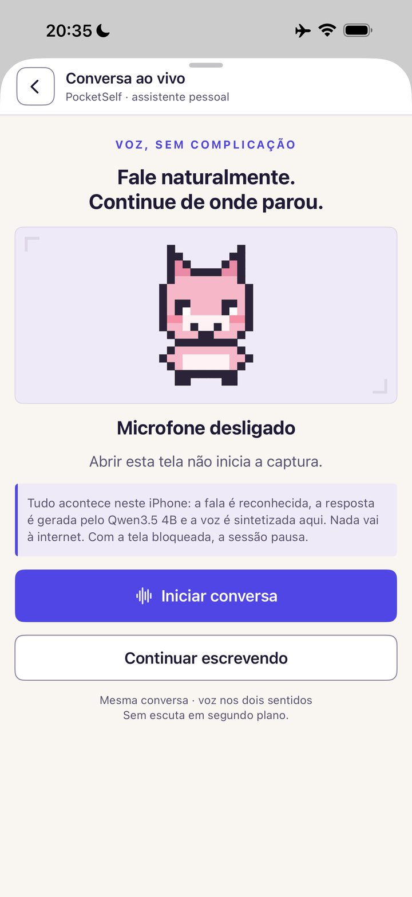
  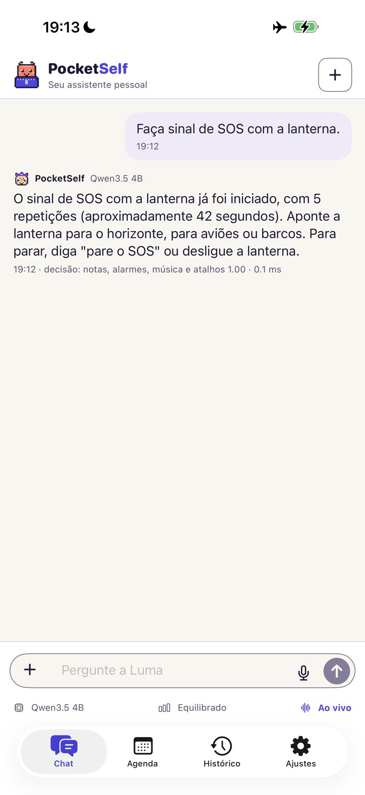
  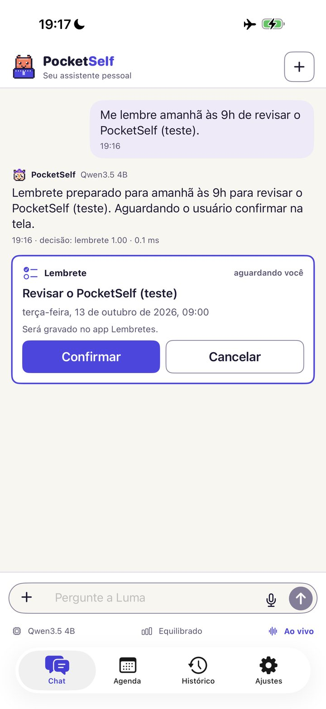
  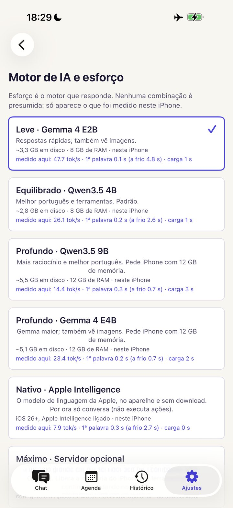
</p>

Todas as telas são capturas reais de um iPhone 17 Pro Max. Tour completo: [docs/APRESENTACAO.md](docs/APRESENTACAO.md).

## Monte o seu agente

<p align="center">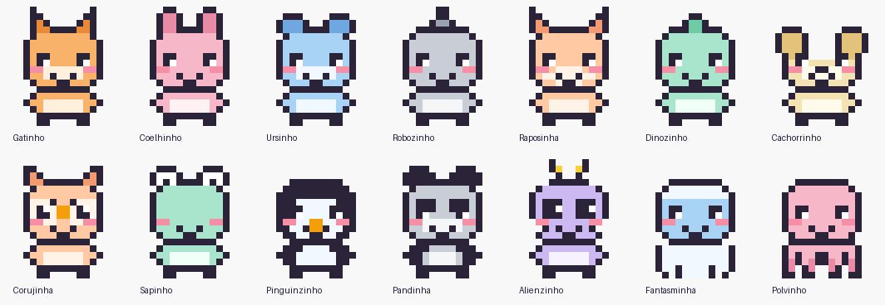</p>

14 personagens, 14 acessórios, 8 objetos para segurar, 8 cores e 4 expressões. Apresentação completa com telas reais: [docs/APRESENTACAO.md](docs/APRESENTACAO.md) · copy e peças de divulgação: [docs/marketing/COPY.md](docs/marketing/COPY.md).

## Estrutura do repositório

```
app/                  o aplicativo (SwiftUI) — project.yml → xcodegen → PocketSelf.xcodeproj
agente-iphone/        agente de controle: runner XCUITest que roda no iPhone (+ lógica pura testável)
scripts/              verificar-ambiente · instalar-no-iphone · agente-iphone · anti-dados-pessoais · verificar-contraste · gerar-marca
tests/                testes de lógica (rodam no Mac, sem aparelho): bash tests/testar.sh
docs/                 marca, instalação, requisitos, assinatura de 7 dias, Apple Intelligence, arquitetura, funcionalidades…
evidence/             logs reais de aparelho e de compilação (sem capturas pessoais)
AGENTS.md / CLAUDE.md instruções para Claude Code e Codex operarem este repositório
```

## Requisitos em uma linha

Mac com Xcode 26+ · iPhone com iOS 18+ (app público validado no 17 Pro Max) · cabo · Apple ID gratuito · `xcodegen`. Lista completa, com o que é opcional: [docs/REQUISITOS.md](docs/REQUISITOS.md).

## Privacidade e segurança

Sem conta, sem telemetria. Histórico, memória e decisões ficam no app. Ação com efeito externo (enviar, agendar, ligar, apagar) só acontece depois da sua confirmação na tela. O agente de controle **nunca** envia, paga, exclui, publica nem digita senha sozinho. Veja [SECURITY.md](SECURITY.md).

## Contribuir

[CONTRIBUTING.md](CONTRIBUTING.md). Antes de abrir um PR: `bash tests/testar.sh` e `bash scripts/anti-dados-pessoais.sh`.

## Licença

[MIT](LICENSE). Os modelos baixados têm licenças próprias (veja [docs/MODELOS.md](docs/MODELOS.md)).
